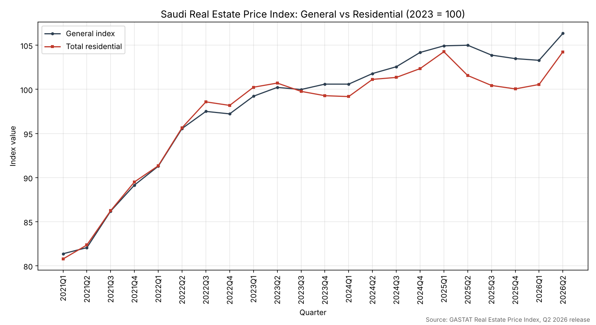

# Saudi Real Estate Price Index (REPI): Data Analysis Project

**مؤشر أسعار العقارات السعودي: تحليل بيانات القطاع العقاري**

▶ **[View the live dashboard / عرض اللوحة التفاعلية](https://waheedsaif78.github.io/saudi-real-estate-price-index-analysis/repi_dashboard.html)** · 📊 [Executive presentation / العرض التنفيذي (PDF)](repi_executive_deck.pdf)



## At a glance

An end-to-end analysis of GASTAT's official Real Estate Price Index (Q2 2026 release, 2023 = 100, 2021Q1–2026Q2, 22 quarters). It covers regional performance, property-type trends, volatility, seasonality and a baseline forecast. The results are delivered as an interactive dashboard and a 16-slide executive deck.

**Key findings**

- **Riyadh leads by a wide margin:** +55.9% cumulative growth since 2021Q1, against +18.2% for the next two regions (Makkah and Al-Jouf).
- **Al-Baha is the outlier:** −32.1% cumulative, the weakest of all regions. The local causes need further checking.
- **Residential land grew most with relatively low volatility:** +33.6% cumulative (σ = 2.42). Villas were the most volatile (σ = 4.01) and fell −9.7% in the latest year.
- **Preliminary seasonality:** Q2 has had the highest average quarterly growth for the general index (+1.8%) and residential (+1.72%). Q4 has been the weakest.

**Built with:** Python (pandas, openpyxl, statsmodels, NumPy), Plotly.js, Jupyter, pptxgenjs.

**Related project:** [Saudi Housing Finance & Macro](https://github.com/waheedsaif78/saudi-housing-finance-macro) tests whether mortgage finance and interest rates explain these price movements.

---

<div dir="rtl">

## نظرة عامة على المشروع

تحليل تطبيقي شامل لمؤشر الرقم القياسي لأسعار العقارات (REPI) الصادر عن الهيئة العامة للإحصاء في المملكة العربية السعودية، بهدف استخراج رؤى قابلة للاستخدام في دعم قرارات الاستثمار والتطوير العقاري: أي المناطق تشهد أعلى نمو، كيف تتباين أنواع العقار (أراضٍ سكنية / فلل / شقق) في الأداء والمخاطر، وهل توجد أنماط موسمية يمكن البناء عليها — وصولاً إلى توصية استراتيجية واضحة لتخصيص رأس المال، معروضة بصيغة تنفيذية (PowerPoint) ولوحة تفاعلية (Dashboard).

## مصدر البيانات

| البند | القيمة |
|---|---|
| المصدر | الهيئة العامة للإحصاء (GASTAT) |
| المؤشر | الرقم القياسي لأسعار العقارات — REPI |
| الإصدار | الربع الثاني 2026 |
| سنة الأساس | 2023 = 100 |
| التغطية الزمنية | 2021Q1 – 2026Q2 (22 ربعاً) |
| الرابط الرسمي | [stats.gov.sa/ar/indicators/48](https://www.stats.gov.sa/ar/indicators/48) |

**مصادر تكميلية موثّقة** (للسياق السوقي فقط، لا تُدمج في مؤشر REPI): CBRE (مراجعة السوق العقاري السعودي)، JLL (بيانات الإيجارات)، Global Property Guide / Knight Frank (معدلات العائد الإيجاري).

**قيد منهجي مهم:** الملف الرسمي لا يوفر تقاطعاً بين المنطقة ونوع العقار معاً — بل جدولان منفصلان: مؤشر حسب نوع العقار على مستوى المملكة، ومؤشر حسب المنطقة الإدارية لكل الأنواع مجتمعة.

## أسئلة التحليل

1. ما اتجاه المؤشر العام للسوق السكني والتجاري عبر الزمن؟
2. أي المناطق الإدارية سجّلت أعلى/أقل نمو تراكمي؟
3. كيف يختلف أداء الأراضي السكنية عن الفلل والشقق من حيث النمو والتقلب؟
4. هل توجد أنماط موسمية ربعية متكررة؟
5. ما التوقع الأولي للمؤشر العام في الأرباع القادمة، وفق سيناريوهات متعددة؟
6. أين ينبغي تخصيص رأس المال الاستثماري والتطويري استراتيجياً؟

## أبرز النتائج

- **الرياض تتصدر بفارق كبير:** نمو تراكمي +55.9% منذ 2021Q1، مقارنة بـ +18.2% لأقرب منطقتين (مكة المكرمة والجوف).
- **الباحة الاستثناء الأبرز:** انخفاض تراكمي حاد بنسبة -32.1%، وهو الأسوأ أداءً بين كل المناطق ويستدعي تحققاً إضافياً من الأسباب المحلية.
- **الأراضي السكنية الأعلى نمواً والأقل تقلباً نسبياً** بين فئات الأصول الفرعية (+33.6% نمو تراكمي، σ=2.42)، بينما سجّلت الفلل أعلى تقلب (σ=4.01) وأحدث تراجع سنوي حاد (-9.7%).
- **نمط موسمي أولي:** الربع الثاني يسجل تاريخياً أعلى متوسط نمو ربعي لكل من المؤشر العام (+1.8%) والسكني (+1.72%)، بينما الربع الرابع الأضعف.
- **التوصية الاستراتيجية (توضيحية):** تركيز التخصيص الرأسمالي على الرياض وفئة الأراضي السكنية، مع إخضاع أي تخصيص في منطقة الباحة لتحقق ميداني مسبق (التفاصيل الكاملة في العرض التنفيذي).

## المنهجية والأدوات

- **الاستخراج والتنظيف:** `pandas`, `openpyxl` — تحويل الجداول الرسمية متعددة المستويات إلى بنية Tidy طويلة (long format)، مع تحقق من اكتمال السلاسل الزمنية وغياب القيم الناقصة/المكررة.
- **التحليل الاستكشافي:** إحصاء وصفي، ترتيب مقارن، تحليل تقلب (rolling std)، تحليل موسمية.
- **التنبؤ الأولي:** اتجاه خطي (`numpy.polyfit`) وتمهيد أسي مع اتجاه (`statsmodels.tsa.holtwinters.ExponentialSmoothing`) كخط أساس، وليس نموذجاً نهائياً؛ مع تحليل سيناريو (متفائل/أساسي/متحفظ).
- **اللوحة التفاعلية:** HTML/JS + `Plotly.js`، تصميم RTL كامل، تتضمن قسم السياق السوقي التكميلي والتوصية الاستراتيجية.
- **العرض التنفيذي:** PowerPoint (`pptxgenjs`) — 16 شريحة بتصميم RTL، تشمل شريحة قرار واحد، رسوماً بيانية أصلية، إطار عمل IRR/NPV (توضيحي)، مصفوفة مخاطر/فرص، وخارطة طريق تنفيذية.

## هيكل المشروع

</div>

```
├── 01_data_import_cleaning.ipynb    # استخراج البيانات الرسمية وتنظيفها
├── 02_eda_and_forecast.ipynb        # التحليل الاستكشافي والتنبؤ الأولي
├── REPI_Q2_2026_AR_EN__1_.xlsx      # الملف الرسمي من الهيئة العامة للإحصاء
├── repi_by_region_clean.csv         # المؤشر حسب المنطقة بعد التنظيف
├── repi_by_type_clean.csv           # المؤشر حسب نوع العقار بعد التنظيف
├── repi_latest_snapshot.csv         # آخر قراءة لكل سلسلة
├── repi_dashboard.html              # اللوحة التفاعلية (Plotly, RTL)
├── repi_executive_deck.pptx / .pdf  # العرض التنفيذي
├── preview_general_vs_residential.png
└── requirements.txt
```

<div dir="rtl">

## طريقة التشغيل

</div>

```bash
pip install -r requirements.txt
jupyter notebook 01_data_import_cleaning.ipynb
jupyter notebook 02_eda_and_forecast.ipynb
```

<div dir="rtl">

- لعرض اللوحة التفاعلية: افتح `repi_dashboard.html` في المتصفح، أو عبر [الرابط المنشور على GitHub Pages](https://waheedsaif78.github.io/saudi-real-estate-price-index-analysis/repi_dashboard.html).
- لعرض الشرائح: افتح `repi_executive_deck.pptx` في PowerPoint أو `repi_executive_deck.pdf` في المتصفح.

## قيود التحليل

- حجم العينة الزمنية (22 ربعاً) محدود لتحليل موسمية إحصائي رسمي أو نمذجة ARIMA/SARIMA كاملة.
- نموذج التنبؤ المرفق نموذج أساسي (Baseline) لأغراض منهجية، وليس أداة اتخاذ قرار استثماري.
- لا تتوفر بيانات على مستوى تقاطع (منطقة × نوع عقار) في الملف الرسمي المستخدم.
- لا تتضمن البيانات تدفقات نقدية — أرقام IRR/NPV في العرض التنفيذي توضيحية بالكامل ومبنية على مثال افتراضي، وليست مرتبطة بمشروع فعلي؛ يجب استبدالها ببيانات مشروع حقيقي قبل أي استخدام في اتخاذ القرار.
- مؤشرات الشواغر/الامتصاص/العائد الإيجاري في قسم "السياق السوقي" مصادرها خارجية (CBRE/JLL/Global Property Guide) وليست جزءاً من مؤشر REPI الأساسي.

## عن المشروع

مشروع ضمن ملف أعمال (portfolio) لتحليل بيانات قطاع التطوير العقاري في المملكة العربية السعودية، ينفّذ دورة كاملة: من استخراج بيانات رسمية وتنظيفها، إلى تحليل استكشافي متعمق، إلى نموذج تنبؤي أولي وتحليل سيناريو، إلى لوحة تفاعلية وعرض تنفيذي جاهزَين للعرض على الإدارة العليا.

</div>

---

## Author and license

Built by [Waheed Saif](https://www.linkedin.com/in/waheed-saif-abdelwahed). This is a personal project using public data only. It does not represent the views of any employer and is not investment advice.

مشروع شخصي مبني على بيانات عامة فقط، ولا يمثّل رأي أي جهة عمل، وليس نصيحة استثمارية.

The code is released under the [MIT License](LICENSE). The GASTAT source file remains subject to the publisher's terms of use.
